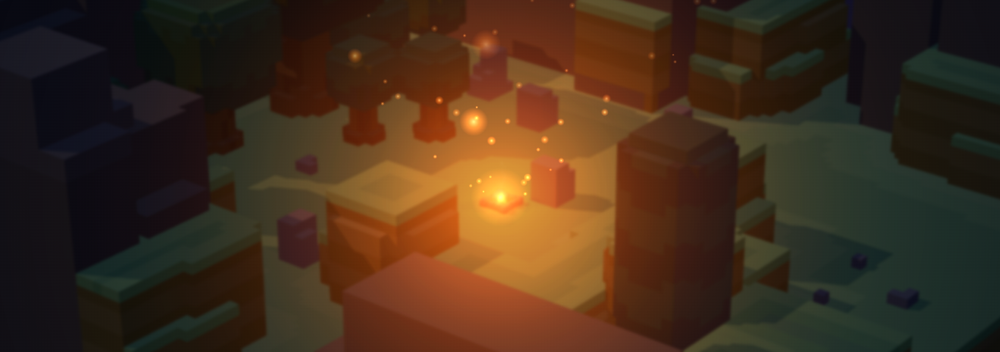

  

  

<h1 align="center">Hearthmakers</h1>

  <b>One hearthling. Your realm. A world to build together.</b> 
  A voxel game made as a tribute to Stonehearth, in development.

  

## About the game

In Hearthmakers each player is a single hearthling, moved by point and click. Your hearthling lives in a realm of its own, raised from a biome, where you gather, dig, build and craft.

Realms live on a server, together with public places that everyone shares. Invite friends to your realm, meet others out in the world, form a party and trade what you have made.

## Features

- **Your hearthling.** One hearthling per player, moved by point and click, with attributes, health, stamina and gear.
- **Realms and places.** Personal realms on a server, with invites for friends, and public places open to everyone. Each realm rises from its biome: temperate, desert or arctic.
- **Harvest and dig.** Fell trees and break boulders with your tool belt, and dig, fill and level the voxel terrain, tunnels included.
- **Blueprints.** Draw structures in stone, dirt, wood, clay and bricks, with walls and building patterns, then build them in your realm block by block.
- **Crafting and colonists.** Workbenches and colonists who work by them, take on tasks, grow farms, patrol and dress for their profession.
- **Combat and levels.** Fight entlings and stone golems, earn experience and level up.
- **Play together.** Chat with channels and commands, parties, trades and friends that stay across sessions.
- **Touch screens too.** Every feature also works on touch screens in landscape.

## Community

Follow the development and talk with the team on [Discord](https://discord.gg/wvG9pxJbRN). Everyone who joins receives the **Hearthling Precursor** role.

---

Hearthmakers is a tribute to Stonehearth. © 2026 The Gearfinder Studios

