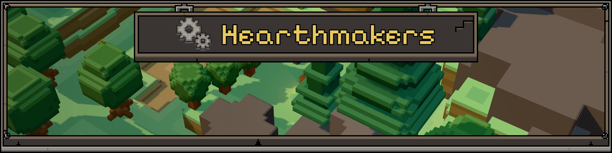
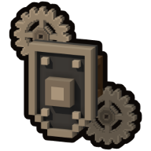

  

  

<h1 align="center">Hearthmakers</h1>

  <b>One pioneer. Your realm. A world to build together.</b> 
  A social voxel game of building and settling, inspired by Stonehearth, in development.

  
  
  
  

## About the game

In Hearthmakers each player is one pioneer, moved by point and click or with a controller. Your pioneer has a realm of its own, raised from a biome (temperate, desert, arctic or industrial), where you dig, build, farm and craft, and where colonists work beside you. Out in a server's public worlds there are villages, forts and dungeons to explore with friends.

There is no central server: anyone can host one, each with its own accounts, and players add servers by their address. Playing alone is a server of your own, hosted by the app on your computer or phone.

## Features

- **Your pioneer.** Attributes, health and stamina, experience and levels, classes, gear, and a tool belt that holds a grappling hook.
- **Realms to shape.** Dig, fill and level the voxel ground, tunnels included, and set down workbenches and furniture.
- **Blueprints.** An editor with walls, rooms, roofs, floors, stairs, doors and windows, and parts that turn, such as a windmill's sails. Colonists build them block by block.
- **Colonists.** Your realm's colonists take a profession at a workbench (builder, farmer, guard, smith, miner, beekeeper, herder, engineer, botanist) and grow with their work: farms, mines, pens of animals, bee couriers, minecarts and expeditions.
- **Research.** Tech trees for your realm and for your pioneer.
- **Adventure.** Public worlds with folk, shops and quests, mobs of each biome, and party instances with an objective and a reward.
- **Together.** Chat with channels, parties, trades, friends and emotes.
- **Wherever you play.** Windows, Linux and Android. Every feature works on touch screens in landscape, and with a controller.

## Play

| Platform | Download |
|---|---|
| Windows | `Hearthmakers-Setup-<version>.exe` from the [latest release](https://github.com/Hearthmakers/Hearthmakers-Releases/releases/latest) |
| Linux | `Hearthmakers-<version>.AppImage` from the [latest release](https://github.com/Hearthmakers/Hearthmakers-Releases/releases/latest) |
| Android | `Hearthmakers-<version>.apk` from the [Android releases](https://github.com/Hearthmakers/Hearthmakers-Releases/releases?q=android&expanded=true) |

The apps keep themselves and the game up to date. Their **Singleplayer** hosts a world of your own, for playing alone or with your home network; **Multiplayer** holds the servers you add.

## Host a server

A server is a single executable for Windows or Linux x64, with everything it needs inside. Download it from the [server releases](https://github.com/Hearthmakers/Hearthmakers-Releases/releases?q=server&expanded=true), run it in a folder of its own and set it up in a `server.env` beside it. It serves its owner a panel in the browser, on that machine only: players, worlds, backups, settings and updates.

- **Pterodactyl:** import the [Hearthmakers egg](https://hearthmakers.the-gearfinder.org/server/egg-hearthmakers.json).
- **Plugins:** make a server your own with commands, rules, rewards, events and windows. See the [Plugin API docs](https://github.com/Hearthmakers/Hearthmakers-Docs).

## Repositories

| Repository | What it holds |
|---|---|
| [Hearthmakers-Releases](https://github.com/Hearthmakers/Hearthmakers-Releases) | The desktop, Android and server downloads, and the website with the development blog |
| [Hearthmakers-Docs](https://github.com/Hearthmakers/Hearthmakers-Docs) | Notes on the game, hosting and the Plugin API |

## Community

Follow the development on the [blog](https://hearthmakers.the-gearfinder.org) and talk with the team on [Discord](https://discord.gg/wvG9pxJbRN).

---

A tribute and homage to Stonehearth. Proudly made with AI. © 2026 The Gearfinder Studios

